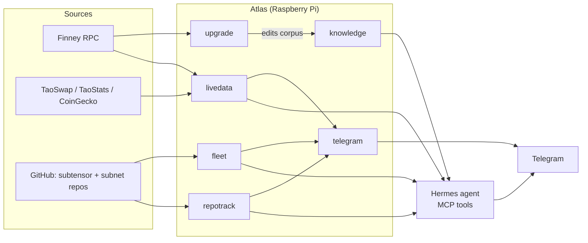

<div align="center">

# Atlas

**A self-hosted Bittensor analyst that runs on a Raspberry Pi.**

Cited answers. Fail-closed data. No third-party dependencies.

<p>
  
  
  
  
  
  <a href="LICENSE"></a>
  
  
  <a href="https://github.com/vanlabs-dev/atlas/actions/workflows/readme.yml"></a>
</p>

<p>
  <a href="#how-it-fits-together">Architecture</a> ·
  <a href="#components">Components</a> ·
  <a href="#getting-started">Getting started</a> ·
  <a href="#documentation">Docs</a>
</p>

</div>

---

Atlas keeps a verified knowledge base, the subtensor source, live market data
and every subnet's code repository on one small device. An LLM agent answers
questions from those sources only, and says so when it has no evidence. A
notifier sends the few changes worth reading to Telegram.

- **Cited or silent.** Answers carry a source: a corpus fact with its date, a
  commit and file path, or a provider reading with its freshness. No source
  means a stated refusal, not a guess.
- **Fail closed.** A stale, partial or contradictory input is reported as
  unavailable. It is never filled in.
- **Read-only toward the world.** Atlas reads public data and clones public
  repositories. It never builds, runs or executes subnet code, and it holds no
  wallet keys.
- **Python standard library only.** No third-party packages to install.

## How it fits together



Each component writes its own SQLite store under the gitignored `var/` and
exposes read-only MCP tools to Hermes: `atlas-kb`, `atlas-repo`, `atlas-live`
and `atlas-fleet`. Scheduled work runs as user-level systemd timers.

## Components

<!-- BEGIN:components -->
| Directory | Role |
|---|---|
| [`knowledge/`](knowledge/README.md) | Validated Bittensor corpus, search store and the `atlas-kb` MCP server |
| [`repotrack/`](repotrack/README.md) | Verified clone of the subtensor repository, change records, `atlas-repo` MCP server |
| [`livedata/`](livedata/README.md) | Fail-closed TaoSwap, TaoStats, CoinGecko and chain-RPC readers, gate and parameter watches, `atlas-live` MCP server |
| [`fleet/`](fleet/README.md) | Clones every subnet's repository, indexes it, scores rotation and mining signals, serves the LAN board and `atlas-fleet` |
| [`telegram/`](telegram/README.md) | Alert classes, tiers, delivery ledger, plain-English rewrite, daily briefing |
| [`upgrade/`](upgrade/README.md) | Runtime upgrade job: detects a new spec, edits the corpus in a worktree, gates and pushes |
| [`subnt/`](subnt/README.md) | Public-edition exporter (retired, code kept) |
| [`hermes/`](hermes/README.md) | Read-only verifiers for the Hermes agent baseline, memory and model |
| [`inventory/`](inventory/README.md) | Read-only device inventory collector |
| [`hardening/`](hardening/README.md) | Read-only security-posture assessor and the operator-approved apply scripts |
| [`tools/`](tools/) | Repository tooling, including this README generator |
| [`web/`](web/) | The subnt.dev site: Next.js pages over a typed data layer |
<!-- END:components -->

## What it does

<!-- BEGIN:capabilities -->
| Capability | Purpose |
|---|---|
| [`agent-voice`](openspec/specs/agent-voice/spec.md) | One voice for every operator-facing surface. |
| [`chain-read-probe`](openspec/specs/chain-read-probe/spec.md) | Proves that every storage item Atlas reads still exists on the live chain with the expected shape, so a runtime rename or removal is caught instead of read silently as a default. |
| [`device-inventory`](openspec/specs/device-inventory/spec.md) | Collect a read-only inventory of the target device (hardware, OS, users, services, listening ports) as a redacted, schema-valid record. |
| [`econ-alert-intelligence`](openspec/specs/econ-alert-intelligence/spec.md) | Put a language-model materiality judgment between econ-path detection and the operator's phone. |
| [`fleet-rotation-metrics`](openspec/specs/fleet-rotation-metrics/spec.md) | Turn the subnet-repo fleet's read-only data into a rotation cockpit. |
| [`fleet-search`](openspec/specs/fleet-search/spec.md) | Read-only code search over the subnet-repo fleet. |
| [`fleet-signals`](openspec/specs/fleet-signals/spec.md) | Turn the subnet-repo fleet's recorded change ranges into operator trading signals. |
| [`hardening-apply`](openspec/specs/hardening-apply/spec.md) | Apply operator-approved hardening items to the device, one at a time, each verified afterwards. |
| [`hardening-assessment`](openspec/specs/hardening-assessment/spec.md) | Assess the device's security posture, read-only, against the eleven ATLAS-ENV-003 areas and report findings without changing anything. |
| [`hermes-baseline`](openspec/specs/hermes-baseline/spec.md) | Verify a manually installed Hermes agent (version, model, tool registration, approval gating) with a read-only check. |
| [`knowledge-base`](openspec/specs/knowledge-base/spec.md) | Serve a validated, dated Bittensor corpus to Hermes through the read-only `atlas-kb` tools, measured against a fixed question battery. |
| [`live-data`](openspec/specs/live-data/spec.md) | Serve current Bittensor data on the device, fail-closed. |
| [`memory-session-recall`](openspec/specs/memory-session-recall/spec.md) | Verify that Hermes memory and session recall work with approval gating on and no secrets retained. |
| [`mining-triage`](openspec/specs/mining-triage/spec.md) | Join what the fleet's clones say a subnet's code requires to what the chain says it pays, and rank subnets by what a NEW INDEPENDENT MINER could earn. |
| [`model-validation`](openspec/specs/model-validation/spec.md) | Validate the agent's model against a scripted battery for tool use, context length, latency and honest refusal. |
| [`pulse-briefing`](openspec/specs/pulse-briefing/spec.md) | Delivers a scheduled Telegram briefing that reads the network and subnet state Atlas already records and reports it as change since the last edition, so the operator samples the pulse on a rhythm instead of receiving an event stream. |
| [`runtime-upgrade`](openspec/specs/runtime-upgrade/spec.md) | Brings Atlas up to date on the Pi, without an operator, when the live runtime spec changes, with every gate enforced in code rather than in a model prompt. |
| [`signal-effectiveness-gate`](openspec/specs/signal-effectiveness-gate/spec.md) | Governs which alert classes are allowed to page the operator, by requiring every netuid-scoped class to be measured against the fleet baseline before it earns an instant tier and to keep being measured after it loses one. |
| [`subnet-repo-fleet`](openspec/specs/subnet-repo-fleet/spec.md) | Maintain a chain-driven fleet of local subnet repository clones. |
| [`subnt-publish`](openspec/specs/subnt-publish/spec.md) | **Retired.** Composes the public subnt.dev edition from facts already recorded in the Atlas stores as schema-valid data files and publishes them into the subnt checkout, so that the page anyone can read carries only recorded, dated, operator-free figures and names every input it does not have. |
| [`subtensor-repo-tracking`](openspec/specs/subtensor-repo-tracking/spec.md) | Track the mainnet subtensor repository on the device. |
| [`telegram-integration`](openspec/specs/telegram-integration/spec.md) | Deliver Atlas alerts to Telegram through a scrubbed, de-duplicated, tiered outbound notifier, with inbound chat handled by the native Hermes gateway. |
<!-- END:capabilities -->

Each row links to its accepted spec. The proposal, design and tasks behind
every change are in [`openspec/changes/archive/`](openspec/changes/archive/).

## Schedule

<!-- BEGIN:schedule -->
| Timer | When | Does |
|---|---|---|
| `atlas-fleet` | Every 6 hours, at :20 | Subnet-repo-fleet reconcile |
| `atlas-poll-chain-head` | Every hour | Live chain-head poll |
| `atlas-probe` | Every hour | Chain-read probe |
| `atlas-repotrack-update` | Every hour | Subtensor repository update |
| `atlas-subnt` | Every 6 hours, at :55 | Subnt public edition (retired, masked) |
| `atlas-upgrade` | Every 30 minutes | Runtime upgrade job |
<!-- END:schedule -->

## Getting started

Atlas needs Python 3.12 or later and `git`. Run the tests of one component:

```bash
python3 -m unittest discover -s fleet/tests
```

Run every suite:

```bash
for d in */tests; do python3 -m unittest discover -s "$d" || break; done
```

To run Atlas against live data, copy [`env.example`](env.example) to `.env`,
set `chmod 600` on it, and fill in the keys it lists. The file explains each
one. Secrets live only in `.env` and never in the repository, logs or output.

## Documentation

| Read | For |
|---|---|
| [`prd.md`](prd.md) | Product requirements, the source of truth |
| [`docs/decisions.md`](docs/decisions.md) | Decisions and acceptance records, dated |
| [`docs/runtime-upgrade.md`](docs/runtime-upgrade.md) | How the unattended runtime upgrade works and what it may edit |
| [`docs/emission-metrics.md`](docs/emission-metrics.md) | How to read TaoSwap emission fields, checked against live data |
| [`docs/device.md`](docs/device.md) | The target device and how its services are laid out |
| [`docs/open-items.md`](docs/open-items.md) | Known debts and decisions still open |
| [`telegram/docs/voice.md`](telegram/docs/voice.md) | The voice rules for chat and alerts |

## Working on Atlas

- **Process.** Changes go through OpenSpec: propose, apply, archive. One change
  per narrow capability.
- **Commits.** Conventional Commits, imperative mood, subject of 50 characters
  or fewer.
- **This README.** The Components, What it does and Schedule tables are
  generated. After changing a component directory, a spec or a timer, run
  `python3 tools/readme_sync.py`. The `tools/tests` suite and CI fail when the
  tables are stale. Add a new top-level component to `COMPONENTS` in
  `tools/readme_sync.py`.
- **Agents.** [`AGENTS.md`](AGENTS.md) holds the identity and push rules for
  automated work.

## Status

Phases 0 to 5 are complete and running on the device. Phase 6, an operator
monitoring frontend, is blocked on open requirements questions. No change is
active. This README states no live chain values on purpose: they go stale in
hours. The current figures are in the knowledge corpus and the records in
[`docs/decisions.md`](docs/decisions.md).
